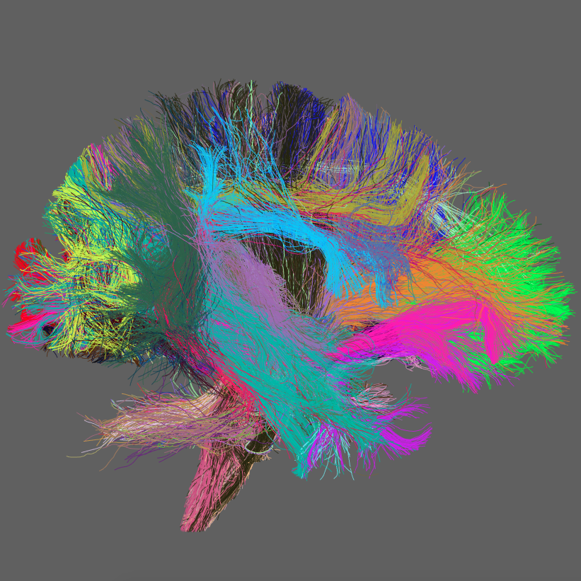

<p align="center">
  
</p>

<h1 align="center">White Matter Anatomy Segmentation</h1>

<p align="center">
  A white matter classification of the major tracts in a whole-brain tractogram, from anatomical rules applied to the FreeSurfer Destrieux parcellation with wma_tools.
</p>

<p align="center">
  <a href="https://github.com/brainlife/abcd-spec"></a>
  <a href="https://doi.org/10.25663/bl.app.41"></a>
  <a href="LICENSE"></a>
</p>

> ⚠️ **This branch, `1.8`, is the deprecated brainlife.io App White Matter Anatomy Segmentation** ([doi:10.25663/bl.app.41](https://doi.org/10.25663/bl.app.41)). It is kept so earlier results stay reproducible. Use **White Matter Anatomy Segmentation** ([doi:10.25663/brainlife.app.188](https://doi.org/10.25663/brainlife.app.188)) instead. The other Apps in this repository are listed under **Versions on brainlife.io** below.

## 🧠 At a glance

<!-- brainlife-app:begin (generated from the App manifest; edit the manifest, not this block) -->

> **Classifies streamlines into known anatomical tracts.**

| | |
|---|---|
| 📥 **Inputs** | `neuro/freesurfer` · `neuro/track/tck` |
| 📤 **Outputs** | `neuro/wmc-deprecated` |
| 🐳 **Container** | `brainlife/freesurfer:6.0.0` |
| ⚙️ **Resources** | 8 CPUs · 31 GB memory · 10 h walltime |
| 🔑 **Requires** | `FREESURFER_LICENSE` |
| 🔗 **Run it** | [doi.org/10.25663/bl.app.41](https://doi.org/10.25663/bl.app.41) |

#### 📥 Inputs

| Input | Datatype | Required | Description |
|---|---|---|---|
| `freesurfer` | `neuro/freesurfer` | yes |  |
| `tracks` | `neuro/track/tck` | yes |  |

#### 📤 Outputs

| Output | Datatype | Description |
|---|---|---|
| `output` | `neuro/wmc-deprecated` |  |

<!-- brainlife-app:end -->

## 🏷️ Versions on brainlife.io

Each version is a separate App on brainlife.io, built from its own branch of this repository.

| App | Output datatype | Branch | Run it | Status |
|---|---|---|---|---|
| White Matter Anatomy Segmentation | `neuro/wmc` | [`3.9`](https://github.com/brainlife/app-wmaSeg/tree/3.9) | [doi:10.25663/brainlife.app.188](https://doi.org/10.25663/brainlife.app.188) | current |
| Posterior Associative White Matter Tracts Segmentation (pArc, TPC, MdLF-SPL, MdLF-Ang, VOF) | `neuro/wmc-deprecated` | [`1.4`](https://github.com/brainlife/app-wmaSeg/tree/1.4) | [doi:10.25663/bl.app.46](https://doi.org/10.25663/bl.app.46) | available |
| **White Matter Anatomy Segmentation** (this branch) | `neuro/wmc-deprecated` | [`1.8`](https://github.com/brainlife/app-wmaSeg/tree/1.8) | [doi:10.25663/bl.app.41](https://doi.org/10.25663/bl.app.41) | deprecated |
| White Matter Anatomy Segmentation with LiFE (takes a `neuro/LiFE` input) | `neuro/wmc-deprecated` | [`1.4`](https://github.com/brainlife/app-wmaSeg/tree/1.4) | [doi:10.25663/bl.app.40](https://doi.org/10.25663/bl.app.40) | deprecated |

### Tract taxonomy

The `3.10` branch, which is not yet registered as an App, updates the wma_tools source to follow current anatomical nomenclature: Meyer's loop becomes the **Inferior optic radiation** (`Inferior_OR`) and Baum's loop the **Superior optic radiation** (`Superior_OR`), so the classification names become `left/rightInferior_OR` and `left/rightSuperior_OR`. The current App (`3.9`) uses the earlier names.

## 🚀 Running the App

### ☁️ On brainlife.io

Open the App at [doi.org/10.25663/brainlife.app.188](https://doi.org/10.25663/brainlife.app.188), choose a `neuro/freesurfer` dataset (the App uses its Destrieux `aparc.a2009s+aseg` parcellation) and a whole-brain tractogram (`neuro/track/tck`) of the same subject in the same space, and press **Execute**. The classification is archived as a `neuro/wmc` dataset.

The segmentation uses a WMQL-like approach ([tract-querier](https://tract-querier.readthedocs.io/en/latest/)), documented in Bullock et al. (2019), and relies on the [wma_tools](https://github.com/DanNBullock/wma_tools) library. After relabelling islands in the parcellation and computing streamline category and geometry priors, it segments, in order: anterior-posterior tracts, corpus callosum, subcortical tracts, frontal aslant, MdLF and ILF, pArc and TPC, optic radiations, cerebellar tracts, VOF, corticospinal tract and cingulum.

### 💻 Locally

You need [Singularity/Apptainer](https://apptainer.org/), [`jq`](https://jqlang.github.io/jq/) and a [FreeSurfer license](https://surfer.nmr.mgh.harvard.edu/registration.html). The segmentation is compiled MATLAB code that runs in `brainlife/mcr:r2019a`; FreeSurfer (`brainlife/freesurfer-mini:6.0.1`) converts the parcellation and `brainlife/pythonvtk:1.1` writes the surfaces.

1. Clone this repository and check out the App branch: `git checkout 3.9`.
2. Create `config.json` with the paths to your inputs (see `config.json.sample`):

   ```json
   {
       "freesurfer": "testdata/freesurfer/output",
       "track": "testdata/track/track.tck"
   }
   ```

3. Export your license and run the App:

   ```bash
   export FREESURFER_LICENSE="$(cat ~/freesurfer/license.txt)"
   ./main
   ```

To run the MATLAB source instead, get [wma_tools](https://github.com/DanNBullock/wma_tools), [vistasoft](https://github.com/vistalab/vistasoft) and [SPM](https://www.fil.ion.ucl.ac.uk/spm/software/) (tested with SPM8); they are also included here as git submodules. Run `main.m`, or [`wma_segMajTracks_BL_v2.m`](https://github.com/DanNBullock/wma_tools/blob/master/wma_segMajTracks_BL_v2.m), after adjusting the `addpath(genpath(...))` statements to your setup.

### 🧪 Sample data

Viable FreeSurfer and tractography inputs on brainlife.io:

- O3D: <https://brainlife.io/pub/5a0f0fad2c214c9ba8624376>
- HCP FreeSurfer: <https://brainlife.io/project/5941a225f876b000210c11e5/detail>
- HCP tractography: <https://brainlife.io/project/5c3caea0a6747b0036dcbf9a/>

## 📦 Outputs

```text
classification/
├── classification.mat   MATLAB struct `classification` with `names` and `index`
├── tracts/              one JSON per tract (up to 1000 streamlines each) and tracts.json
└── surfaces/            cortical surfaces (VTK) from aparc+aseg, with index.json
```

`names` lists the tracts identified. `index` has one entry per streamline of the input tractogram: zero for unassigned streamlines, otherwise the position of the streamline's tract in `names`.

## 🩺 Troubleshooting

- **`Please set FREESURFER_LICENSE in .bashrc`**: export your FreeSurfer license text in `FREESURFER_LICENSE` (brainlife.io provides it automatically).
- **`output missing`**: `classification/classification.mat` was not written. Check the logs, and make sure the tractogram and the FreeSurfer output are from the same subject and in the same space.

## 📚 Citing

> [!TIP]
> If you use this App in your work, please cite the App, the software it builds on and brainlife.io (below). GitHub's **Cite this repository** button gives the App citation in APA and BibTeX.

- Bullock D, Takemura H, Caiafa CF, Kitchell L, McPherson B, Caron B, Pestilli F. Associative white matter connecting the dorsal and ventral posterior human cortex. *Brain Structure and Function* 224(8):2631–2660 (2019). [doi:10.1007/s00429-019-01907-8](https://doi.org/10.1007/s00429-019-01907-8)
- White Matter Anatomy Segmentation. brainlife.io App. [doi:10.25663/bl.app.41](https://doi.org/10.25663/bl.app.41)
- Avesani P, McPherson B, Hayashi S, et al. The open diffusion data derivatives, brain data upcycling via integrated publishing of derivatives and reproducible open cloud services. Sci Data 6, 69 (2019). [doi:10.1038/s41597-019-0073-y](https://doi.org/10.1038/s41597-019-0073-y)
- Fischl. FreeSurfer. *NeuroImage* 62:774-781 (2012). [doi:10.1016/j.neuroimage.2012.01.021](https://doi.org/10.1016/j.neuroimage.2012.01.021)
- Hayashi S, Caron BA, Heinsfeld AS, et al. brainlife.io: a decentralized and open-source cloud platform to support neuroscience research. *Nature Methods* 21:809–813 (2024). [doi:10.1038/s41592-024-02237-2](https://doi.org/10.1038/s41592-024-02237-2)

## 👥 Authors

- Daniel Bullock
- Franco Pestilli (project director)

**Contributors:** Soichi Hayashi, Gabriele Amorosino

## 💰 Funding

[](https://wellcome.org/)
[](https://reporter.nih.gov/project-details/11261037)
[](https://reporter.nih.gov/project-details/11411328)
[](https://reporter.nih.gov/project-details/10262925)
[](https://reporter.nih.gov/project-details/10428625)
[](https://reporter.nih.gov/project-details/10460628)
[](https://reporter.nih.gov/project-details/11140284)
[](https://www.nsf.gov/awardsearch/showAward?AWD_ID=1734853)
[](https://www.nsf.gov/awardsearch/showAward?AWD_ID=2203524)
[](https://www.nsf.gov/awardsearch/showAward?AWD_ID=1636893)
[](https://www.nsf.gov/awardsearch/showAward?AWD_ID=2148729)
[](https://www.nsf.gov/awardsearch/showAward?AWD_ID=1912270)
[](https://www.nsf.gov/awardsearch/showAward?AWD_ID=2148700)
[](https://www.nsf.gov/awardsearch/showAward?AWD_ID=1916518)

<sub>brainlife.io is publicly funded, and acknowledging that support helps keep it running. This App was developed with support from Wellcome, the U.S. National Institutes of Health (including the BRAIN Initiative BRAIN CONNECTS program: The Axonal Projectome EXchange, U24NS140384, and the Center for Mesoscale Connectomics, UM1NS132207) and the U.S. National Science Foundation.</sub>

## ⚖️ License

[MIT](LICENSE). wma_tools, vistasoft and FreeSurfer are distributed under their own licenses.
